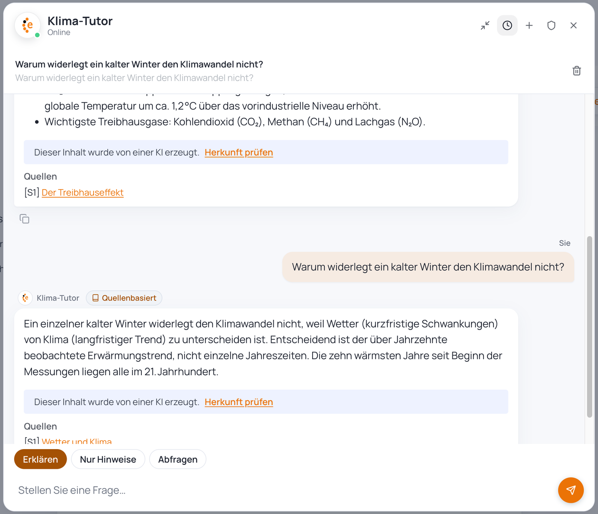
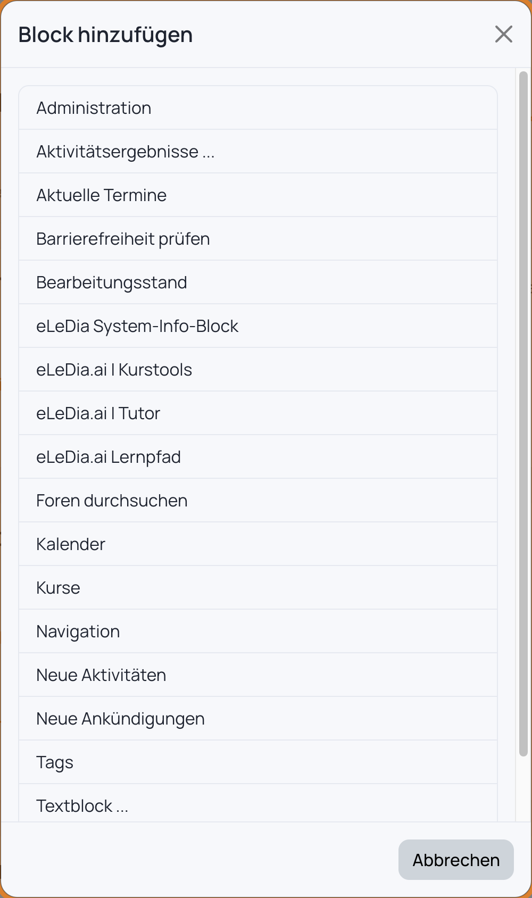
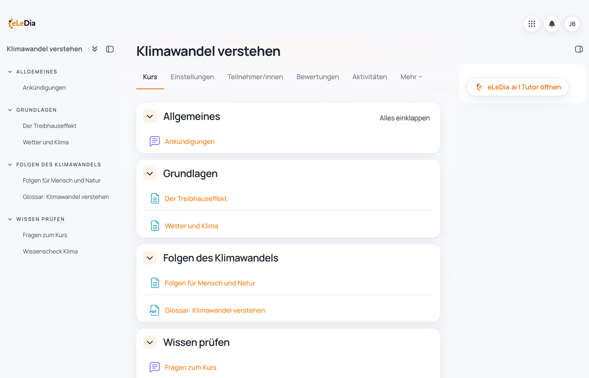

# User and administration documentation

## Meta

Base user documentation of the eLeDia.ai Tutor (`feat01`–`feat08`). Base
language: English (`docsBase: en`); the German version is `02-user-doc.de.md`.
`help.php` shows this file at runtime to everyone whose language is not
German; this section does not appear there. Do not rename or move the file.
State: release 1.0.25.

---

## Audiences

- **Learners** use the tutor as an AI-assisted chat in Moodle.
- **Teachers** place and configure tutor block instances in courses and let the
  tutor interpret what learners asked.
- **Administrators** manage tutor profiles and designs, the privacy text and the
  tutor settings, and set up the connection and limits in the AI Chat Engine.

---

## Product overview

The eLeDia.ai Tutor is a Moodle block for an embedded AI chat. Responses are not
generated in the browser or in the block itself: the suite's AI Chat Engine runs
the conversation and the connected AI service writes the answers, server-side.
Moodle remains the source of trust and context: the tutor operates with the
permissions of the logged-in person and can only use content that this person
may also see in Moodle.

The tutor can appear as a course block, a docked panel, a dialog, a fullscreen
view, a floating launcher on every page, a full-page start page (AI home) and in
the Moodle App. Tutor designs, persona, greeting, suggested questions and answer
style can be customised site-wide and, if permitted, per block instance.

---

## Learners: using the tutor

1. Open Moodle and sign in.
2. Open a course, the dashboard or a page with the eLeDia.ai Tutor.
3. Type a question into the chat field or pick a suggested starter question.
4. Read the answer and ask a follow-up question if needed.

> The screenshots in this document show the German user interface. English screenshots are planned.


Key usage notes:

- **Enter** sends a message, **Shift+Enter** inserts a line break.
- Suggested starter questions appear as chips when they are configured.
- Answer styles can switch between **Explain**, **Hints only** and **Quiz me**,
  provided the site or the block allows it.
- Answers can be copied. Failed answers can be retried.
- **New conversation** (plus) starts a fresh conversation, even when the window
  is currently empty.
- When history is enabled, the history icon opens saved conversations. The bin
  next to a conversation deletes it, here and at the AI agent.
- Answers from course material carry the badge **Source based** and list the activities they rely on under **Sources**. A click opens the activity.
- Answers that do not come from course material are marked as a general answer.
- If the suite's AI labelling is installed, every answer carries a notice that it was generated by AI, with a link to check its provenance.
- While you have a quiz attempt open, the tutor may refuse your messages and
  name the quiz. After submitting, you can use it again (see "Lock during
  quizzes").




### Privacy guidelines, long-term memory and your data

The shield in the tutor's header opens the **privacy guidelines**. There you
find:

- a note that AI answers can be wrong, and what is sent and stored;
- the **long-term memory** switch: it allows the tutor to remember information
  across conversations. It is off by default and only available when the site
  offers it;
- **"See what the tutor has remembered about me"**: an overview of the memories
  by category and of the notes on your conversations with course and date. The
  data is fetched when you open it and is not stored in Moodle. If nothing is
  stored, it says so. If a memory is wrong, tell the tutor in the conversation;
- **"Delete all my tutor data"**.

Switching long-term memory off asks for confirmation first, because everything
remembered is erased at once and for good. **Look first** shows what is stored.
Cancelling or closing the dialog keeps memory switched on.


The text of the privacy guidelines is set by your institution and may differ from the screenshot.

Deleting all tutor data removes the local tutor data. If the AI service offers
deletion tools, external deletion is requested as well; its outcome is reported
separately. Deleting the Moodle account removes the same local tutor data
automatically; external deletion is requested before the account's token
becomes invalid, and service failures never prevent the local cleanup.

### Course context and knowledge base

Within a course, the tutor answers course-related questions, for example about
activities, materials or next steps. Outside a course it can help more
generally, for instance with Moodle navigation or visible courses.

Which material the tutor may answer from is set per block instance:

- **Knowledge base:** course categories and courses. A category includes every
  course below it, also courses added later. Without a selection the tutor
  searches the course it sits in. If the asking person is enrolled in none of
  the selected courses, the tutor answers without course material.
- **Answer source:** "Grounded in course materials" or "General knowledge (LLM
  only)". The second mode exists only when the site allows LLM-only mode. A
  course without an ingested knowledge base then answers from general
  knowledge; if the mode is not allowed, the tutor shows "not available".
- **Pass course context:** sends the current course to the tutor.


Conversation history follows the same scope: global chat lists only global
conversations, while course conversations appear inside their course. If course
access is removed, its conversations are no longer available through the tutor.

---

## Teachers: providing the tutor in a course

1. Turn on editing in the course.
2. Add the **eLeDia.ai Tutor** block.
3. Configure the block via the context menu.
4. Optionally apply, import or export a tutor design.
5. Check the course as a user with `block/elediaai_tutor:use`.

In editing mode you add the block via **Add a block** in the block drawer. The course then shows the button that opens the tutor there.





The block configuration is split into the areas **Design**, **Conversation & display**, **Knowledge base** and **Technical settings**; a **live preview** on the right shows changes immediately.


Key block instance settings:

| Setting | Effect |
|---|---|
| Block title | Heading of the block. |
| Display mode | Docked panel, embedded, dialog or fullscreen. |
| Pass course context | Sends the current course to the tutor. |
| Answer source | Grounded in course materials, or general knowledge where allowed. |
| Knowledge base | Course categories and courses the tutor may answer from. |
| Daily message limit | -1 = site default, 0 = unlimited, otherwise messages per person and day. |
| Greeting and suggested questions | Starter text and clickable starter questions. |
| Persona | Name, role, tone, audience and free-form instructions. |
| Lock during quizzes | Whether this tutor refuses messages while a quiz attempt is open. |
| Design | Colours, surfaces, typography, message bubbles, launcher, logo and avatar. |
| History | Shows saved conversations when allowed. |

Which design and persona fields are visible depends on the site's governance
setting. Locked values always follow the site default.

### Interpreting learners' questions

Teachers with `block/elediaai_tutor:viewreports` open the page **AI
analysis of the questions** in the course. It creates an AI analysis that
summarises where learners struggle and suggests measures, based on anonymised
learner questions. The numbers, topics and the questions themselves are in the
suite's **course insights**, linked from that page. If too few questions have
been logged, the page says so.


Every night the tutor assigns a topic to new questions, if the backend offers
it. A question keeps its topic once assigned. To repair drifted topics, switch
on "Re-label all questions every 14 days"; on that day the numbers change.

How long the questions are kept is set by the suite core ("Keep questions and
answers for" on the *AI audit* page, default 90 days); below 30 days the topic
analysis becomes unusable.

---

## Lock during quizzes

The tutor can refuse messages while a person has a quiz attempt open. Every open
attempt counts, in every course; instead of an answer the tutor names the quiz.
Preview attempts and quizzes the person can no longer reach do not count.
Teachers are exempt through `local/elediaai_chatengine:bypassquizlock`.

The setting **Lock during quizzes** exists site-wide and per block instance:

- **Use site default**: whatever the tutor's site settings say.
- **As set in the chat engine** (default): the AI Chat Engine's site setting
  "Lock the chat during quizzes".
- **Lock** / **Do not lock**: for this tutor, regardless of the site.

The site-wide launcher follows the block instance that unlocks the course.

---

## Administrators: central setup

Setup is split between two places.

### Tutor configuration

The tutor's plugin shell, also under **Site administration > Plugins > Blocks >
eLeDia.ai Tutor**, has the areas **Health** (surfaces, privacy text, last
failure), **Settings**, **Tutors** and **Preview**, plus links to LiteRAG, AI
Sources and MCP when installed.

| Setting | Effect |
|---|---|
| Enable global chat / Enable course chat | Whether general and course conversations are allowed. |
| Site-wide floating tutor | Shows the tutor outside block regions. Courses are still unlocked by adding the tutor block; afterwards the tutor stays available on course subpages and in activities. |
| Allow LLM-only mode | Whether instances may answer from the language model's general knowledge. |
| Require confirmation on first use | Off by default; for institutions that need a documented acknowledgement. |
| Privacy guidelines text | Institution-specific text, always one click away in the tutor. |
| Re-label all questions every 14 days | Off by default. |
| Logging verbosity | How detailed failures are logged. |
| Custom CSS | Trusted adjustments for the `.elediaai-chat-*` classes. |

Under **Technical settings** there are two notes without a value of their own:
**Connection to the agent** links to the AI Chat Engine settings, and
**Retention of questions** links to the suite core's *AI audit* page, where
"Keep questions and answers for" (default 90 days) decides when recorded
questions are deleted. Up to 1.0.22 the tutor offered its own "Question
analytics retention (days)"; it had no effect and was removed in 1.0.23. The
upgrade hands the tutor value to the core if it is shorter than the core's
retention; a longer one is never taken over.

### AI Chat Engine

Connection and limits for every chat surface of the suite are under **Site
administration > Plugins > Local plugins > AI Chat Engine**:

| Setting | Note |
|---|---|
| Agent MCP endpoint, authentication token | Address and access of the RAG agent. Which backend answers follows the destination set in AI Sources. |
| Callback web service | Web service from MCP the user-scoped Moodle tokens are restricted to. |
| Callback token lifetime | Lifetime of those tokens. |
| Offer long-term memory, regroup questions nightly, history and deletion at the agent | Optional agent tools. |
| Request timeout, maximum message length, requests per minute, messages per day | Limits per request and person. |
| Stream answers | Needs an unbuffered web server (see README). |
| Lock the chat during quizzes | Site-wide quiz lock, off by default. |

### Moodle MCP token

Every turn carries a user-scoped Moodle MCP token, grounded or LLM-only: the
backend must know who is asking. For grounded answers the backend also uses it
to call back into Moodle as that learner to fetch their courses, run Moodle AI
tools, sync memory or run remote deletion. Tokens are provisioned server-side,
held briefly in the application cache and never sent to the browser.

### Tutor designs and profiles

Administrators manage tutor designs under **Tutors** in the plugin shell. There
you can apply, duplicate, import and export presets and your own tutor profiles
to the site or to individual block instances.

The settings include, among others:

- Colours, surfaces, lines, typography and shadows.
- Message bubbles and status states.
- Launcher button, footer, logo and avatar. The launcher style **Floating
  button with label (bottom corner)** shows logo and text as a pill; the text
  comes from "Launcher label", and if that is empty the tutor's name is shown.
  Below 768 pixels width it turns back into a circle.
- Chat window width: standard (380 / 640 px), wide (480 / 800 px) or extra wide
  (600 / 960 px) for the docked panel and the dialog. On small screens the
  window never gets wider than the screen.
- Persona, system prompt, greeting and suggested questions; on the dashboard
  separately for learners, teachers and managers.
- Governance over which values may be overridden per block instance.

Greeting, persona, prompt starters, dashboard greeting, launcher label and
footer can be provided in several languages. Each person sees the language
they have set in Moodle, and the AI model receives only that one. Write each
language in a block of its own:

```
<span lang="de" class="multilang">Hallo! Wie kann ich helfen?</span><span lang="en" class="multilang">Hello! How can I help?</span>
```

With the add-on "Multi-Language Content (v2)" the form
`{mlang de}Hallo!{mlang}{mlang en}Hello!{mlang}` works as well. The filter
"Multi-language content" (or v2) has to be switched on under *Site
administration > Plugins > Filters > Manage filters*; "Filter all strings" is
not required.

---

## Moodle App

Because third-party blocks are not rendered in the Moodle App the way they are
on the web, the tutor provides its own page:

```text
https://YOURSITE/blocks/elediaai_tutor/view.php
https://YOURSITE/blocks/elediaai_tutor/view.php?courseid=N
```

`?embedded=1` uses a reduced layout without Moodle chrome. Login, enrolment,
capabilities and limits apply just as they do on the web.

---

## Troubleshooting

| Symptom | Likely cause | Solution |
|---|---|---|
| The tutor shows a hint instead of the chat | No reachable backend, or the course resolves to grounded mode but the callback web service is missing | Set the agent endpoint and the callback web service in the AI Chat Engine; check AI Sources. |
| Tutor service unavailable | Transport error, wrong URL or server error | Test the endpoint from the Moodle server's perspective; check the cURL security helper. |
| Repeated auth errors | Moodle MCP token invalid or web service disabled | Check the MCP web service, capabilities and token lifetime. |
| Messages refused during a quiz | Quiz lock | Check "Lock during quizzes" on the instance and in the AI Chat Engine. |
| Messages too fast | Rate limit active | Adjust the limit in the AI Chat Engine. |
| Answers appear all at once after a wait | Web server buffers the stream | See "Streaming answers" in the README, or switch streaming off. |
| Chat looks outdated | Moodle cache outdated | Purge Moodle caches. |
| Course context missing | Course not ingested, course chat off, no context passed and no knowledge base | Check the block instance, AI Sources and "Pass course context". |

---

## Accessibility

The interface can be operated by keyboard, new answers are announced to screen
readers and reduced motion is respected. Visible focus states are part of the
UI baseline. The overlay panel is a modal dialog.
